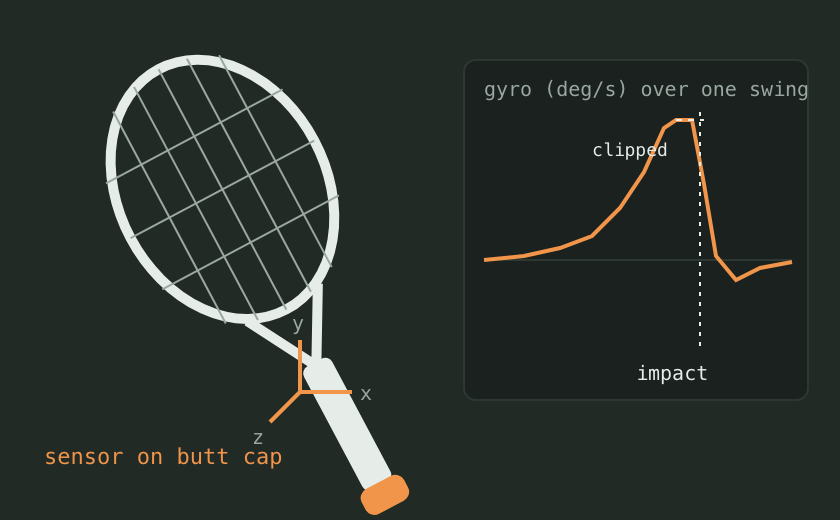
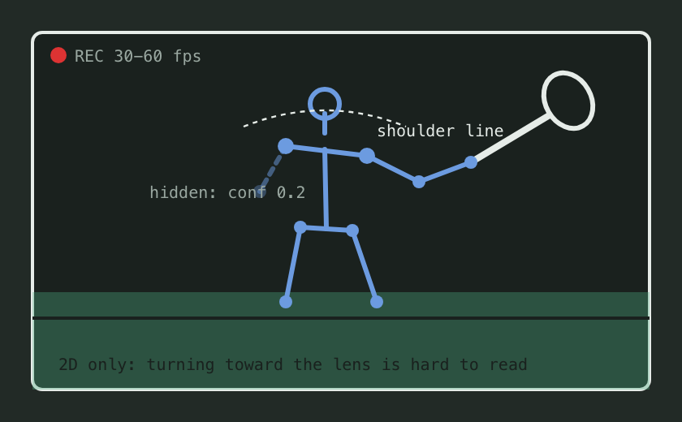
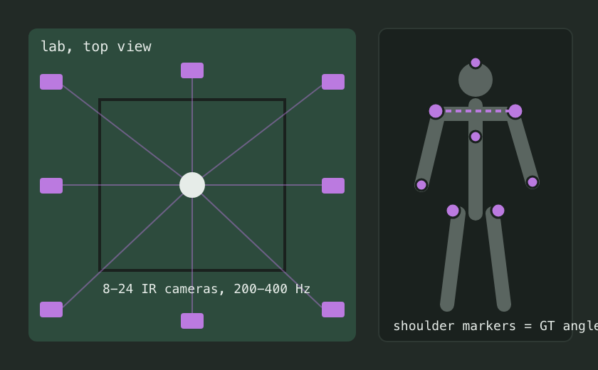
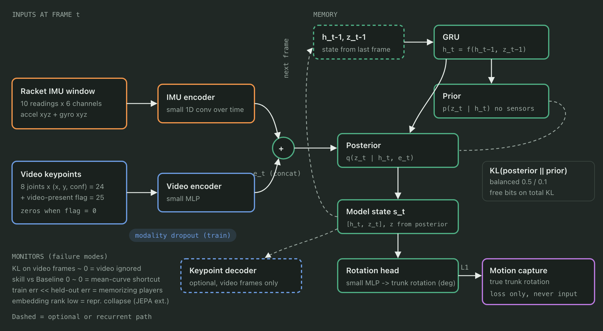
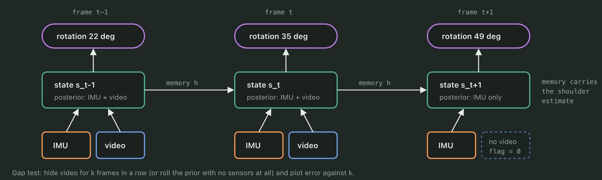

# FramePoint Focused Exercise

**Sparse-sensor motion inference**

Inferring trunk (shoulder-line) rotation during the tennis forehand from a racket-mounted IMU and partial single-camera video, with optical motion capture as ground truth.

## Files

| File | What it is |
|---|---|
| `1_Experiment_Plan.pdf` | The 2-page experiment plan: inputs and labels, baselines and stronger model, leakage-free split, metrics and falsifiable threshold, failure cases, first 30 days |
| `2_RSSM_Pseudocode.pdf` | Pseudocode for the stronger model's training step (recurrent state-space model used as a memory and sensor-fusion filter), with architecture diagrams |
| `images/` | PNG versions of the device illustrations and architecture diagrams used below |
| `3_Sensing_Setups.pdf` | Illustrations of the three devices: racket IMU and single camera (model inputs) and optical motion capture (ground truth only) |

## Summary

- **Target:** trunk rotation in degrees at every video frame of a segmented forehand (-1.0 s to +0.5 s around impact).
- **Inputs:** racket IMU (always on) + 2D pose keypoints from one camera with a video-present flag (sometimes missing or wrong).
- **Ground truth:** optical motion capture (shoulder markers), used only to train and grade.
- **Baselines:** mean curve, gyro physics, ridge regression on IMU features (the threshold baseline), hold-last-angle on video gaps, keypoint geometry on video frames.
- **Stronger model:** a recurrent state-space model. The GRU memory carries the swing, the posterior fuses memory with IMU and keypoints, the prior is trained by KL only so the memory learns to predict the swing and the estimate holds through video gaps. Modality dropout during training.
- **Split:** leave-players-out, 5-fold grouped CV repeated 3 times (15 runs per model), paired across models.
- **Threshold (fixed before training):** MAE < 8 degrees at peak rotation on unseen players and at least 20% better than ridge, with a player-bootstrap 95% CI that excludes zero. Numbers are placeholders to be set from real data.

## Figures

### The three devices

- **Racket IMU (input, always on):** accelerometer + gyroscope on the butt cap. It feels the racket, not the shoulder, and the gyro can clip at impact. Real example: [Zepp tennis sensor](https://www.engadget.com/2014-10-11-irl-zepp-tennis-sensor.html).
- **Single camera (input, sometimes clear):** 2D pose keypoints give the shoulder line directly, but only in 2D and with gaps when the body blocks itself.
- **Motion capture (ground truth, lab only):** shoulder markers give the true trunk rotation used to train and grade. Reference: [Vicon forehand study, ATP pros (JSSM 2010)](https://www.jssm.org/jssm-09-643.xml-Fulltext).

### The stronger model

One video frame: IMU and keypoint encoders feed the posterior, the GRU memory feeds both prior and posterior, KL links them, and the head reads trunk rotation, trained against motion capture only.

Across frames: when video drops out, the posterior uses IMU only and the memory carries the estimate.

## AI use disclosure

I used an AI assistant (Claude) for:

- **Deep understanding of the problem and a clear problem statement:** breaking the exercise into its parts and structuring the plan and pseudocode around them.
- **Understanding the mechanics of the tennis forehand:** learning how trunk rotation, the arm and the racket move together through the swing, from the papers and real-device sources it pointed me to (linked in `3_Sensing_Setups.pdf`).
- **Diagrams and images:** making the architecture diagrams and generating the device illustrations.
- **Making the PDFs:** layout and formatting of the plan, pseudocode and illustration documents.

After that, I did the work myself: the choice of target variable, the model design, the baselines, the split, the metrics and threshold, the failure cases and monitors, and the 30-day plan, and I reviewed and edited each section.
